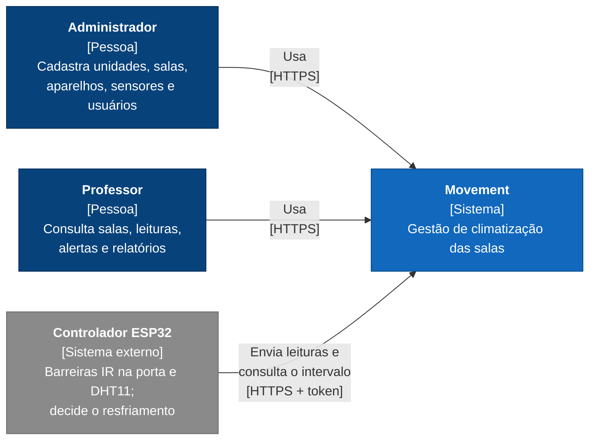
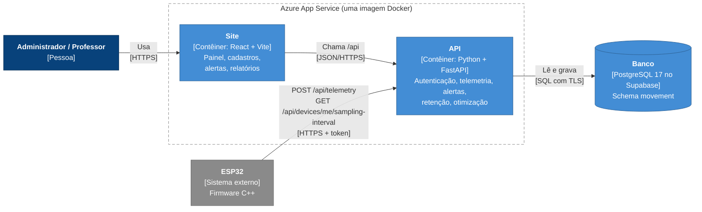
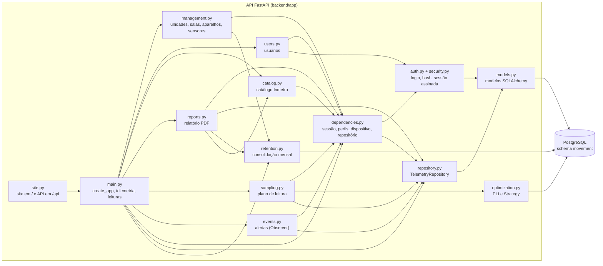
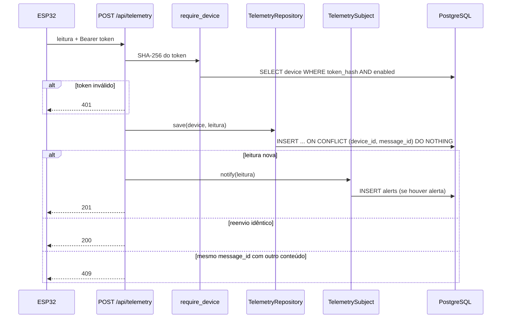
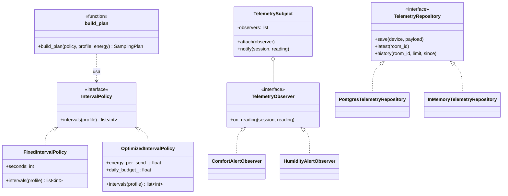

# Arquitetura do Movement

Arquitetura documentada com C4 Model e UML, padrões de projeto GoF e princípios SOLID no backend. Atende ao requisito "Software Architecture & Design Patterns" da ExpoTech 2026.2 ([issue #6](https://github.com/expotech2026-2/Projeto-Movement-2.0/issues/6)).

## 1. Visão geral

O Movement gerencia salas e aparelhos de ar-condicionado e recebe a telemetria de um ESP32 por sala (temperatura, umidade, ocupação e estado do A/C). Administradores cadastram unidades, salas, aparelhos, sensores e usuários; professores consultam o painel, os alertas e os relatórios.

| Camada | Tecnologia |
| --- | --- |
| Interface | React 19 + Vite, Recharts |
| API | Python 3.12, FastAPI, Pydantic |
| Persistência | SQLAlchemy 2.0, Alembic, PostgreSQL 17 gerenciado (Supabase) |
| Otimização | SciPy (`milp`, solver HiGHS) |
| Dispositivo | ESP32 (Arduino C++), duas barreiras infravermelhas na porta e DHT11 (no Wokwi: dois PIR e DHT22) |
| Nuvem e entrega | Docker, Azure Container Registry, Azure App Service, GitHub Actions |

## 2. C4 nível 1 — Contexto

Os níveis 1 e 2 usam `flowchart` com a notação do C4: o tipo de cada elemento aparece entre colchetes, e as cores e a fronteira tracejada seguem o padrão do C4. Os blocos `C4Context` e `C4Container` do Mermaid sobrepunham os rótulos das setas no GitHub.



## 3. C4 nível 2 — Contêineres



O site e a API saem da mesma imagem (`Dockerfile`): `app.site:create_site` serve o build do React em `/` e a API em `/api`.

## 4. C4 nível 3 — Componentes da API

Setas = dependência real de import entre os módulos de `backend/app/`.



`main.py` só monta a aplicação e os endpoints de telemetria e leitura; cada área tem seu router (`create_*_router()`). `optimization.py` e `retention.py` não dependem de outros módulos do app, só do banco.

## 5. UML de sequência — telemetria



O ESP32 gera um `message_id` (UUID) por leitura e reenvia o mesmo conteúdo até receber confirmação. A chave única `(device_id, message_id)` torna o envio **idempotente**: reenvios não duplicam leituras nem alertas.

## 6. UML de classes — padrões



`InMemoryTelemetryRepository` existe só nos testes (`backend/tests/test_architecture.py`).

## 7. Padrões de projeto

### 7.1 Strategy (GoF, comportamental)

**Problema:** o intervalo de envio do ESP32 pode ser calculado de formas diferentes (fixo de 16 s, como no firmware original, ou otimizado por programação linear inteira), e o painel precisa comparar as duas sem duplicar código.

**Papéis:** `IntervalPolicy` = *Strategy*; `FixedIntervalPolicy` e `OptimizedIntervalPolicy` = *ConcreteStrategy*; `build_plan` (e as rotas de `sampling.py` que o chamam) = *Context*.

**Onde:** `backend/app/optimization.py`.

```python
baseline = build_plan(FixedIntervalPolicy(), profile, energy)
plan = build_plan(OptimizedIntervalPolicy(energy, budget), profile, energy)
```

Uma política nova (por exemplo, um intervalo maior aos fins de semana) é uma classe nova com `intervals(profile)`; nem `build_plan` nem as rotas mudam.

### 7.2 Observer (GoF, comportamental)

**Problema:** cada leitura nova pode disparar reações diferentes (alerta de conforto, alerta de umidade e, no futuro, notificações). O endpoint de telemetria não deve conhecer cada uma delas.

**Papéis:** `TelemetrySubject` = *Subject*; `TelemetryObserver` = *Observer*; `ComfortAlertObserver` (sala ocupada acima de 28 °C) e `HumidityAlertObserver` (umidade acima de 70%) = *ConcreteObserver*.

**Onde:** `backend/app/events.py`; o endpoint `POST /telemetry` em `main.py` chama `notify` só para leituras novas.

```python
subject = TelemetrySubject()
subject.attach(ComfortAlertObserver())
subject.attach(HumidityAlertObserver())
...
subject.notify(session, reading)  # cada observador decide se gera alerta
```

Os alertas ficam na tabela `alerts` (migração 0005), aparecem no painel e são registrados no log `movement.alerts`, que o Azure mostra no Log stream.

### 7.3 Repository (Fowler, PoEAA — **não é GoF**)

**Problema:** isolar a persistência das leituras (inserção idempotente, última leitura, histórico) do resto da API.

**Onde:** `TelemetryRepository` (protocolo) e `PostgresTelemetryRepository` em `backend/app/repository.py`.

Repository é um padrão do catálogo de Martin Fowler (*Patterns of Enterprise Application Architecture*), não dos 23 padrões do GoF. Ele é citado aqui porque é a base da inversão de dependência (seção 8); os padrões GoF do projeto são **Strategy** e **Observer**.

## 8. Princípios SOLID

| Princípio | Onde aparece |
| --- | --- |
| **S** — responsabilidade única | Cada módulo tem um motivo para mudar: `auth.py` (sessão), `repository.py` (persistência de leituras), `retention.py` (consolidação mensal), `reports.py` (PDF), `catalog.py` (catálogo), `optimization.py` (PO), `events.py` (alertas) |
| **O** — aberto/fechado | Alerta novo = nova classe Observer anexada em `default_subject()`, sem alterar o endpoint; política de intervalo nova = nova Strategy, sem alterar `build_plan` |
| **L** — substituição de Liskov | `InMemoryTelemetryRepository` substitui o de PostgreSQL em `test_architecture.py` e os endpoints continuam corretos; qualquer `IntervalPolicy` funciona em `build_plan` |
| **I** — segregação de interfaces | Protocolos pequenos e específicos: `TelemetryRepository` (3 métodos), `TelemetryObserver` (1), `IntervalPolicy` (1) |
| **D** — inversão de dependência | Os endpoints de telemetria, última leitura e histórico recebem o protocolo `TelemetryRepository` por `Depends(telemetry_repository)`, não a classe do PostgreSQL; `create_app(settings)` recebe a configuração por injeção; as políticas recebem energia e orçamento pelo construtor |

## 9. Decisões de arquitetura

| Decisão | Motivo |
| --- | --- |
| Monólito modular numa única imagem | Equipe pequena e prazo curto: um deploy, um domínio, sem CORS em produção; os módulos continuam separados por router |
| Banco gerenciado (Supabase) | Backups, atualizações e disponibilidade ficam com o provedor; conexão pelo Session pooler com TLS |
| Schema `movement` | O schema `public` do Supabase é exposto pela API REST com a chave anônima |
| Telemetria idempotente | `message_id` por leitura + chave única evita duplicatas quando o ESP32 reenvia |
| Retenção de 30 dias + resumo mensal | Detalhe recente para o painel, médias de 12 meses sem crescimento ilimitado do banco |
| Token de dispositivo com hash SHA-256 | O banco guarda só o hash; o token aparece uma única vez no cadastro |
| Sessões assinadas com expiração | Trocar a senha ou desativar o usuário invalida as sessões abertas |
| Plano de leitura otimizado | Reduz a energia do ESP32 sem perder qualidade nas horas ocupadas ([Pesquisa Operacional](pesquisa-operacional.md)) |
| CI/CD com `Devlop` e `main` | Todo PR roda lint, testes e build da imagem; só a `main` publica no Azure |
