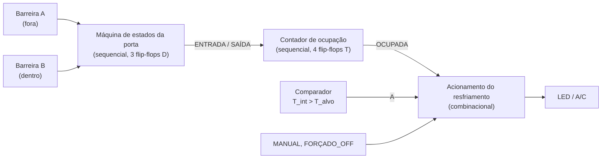
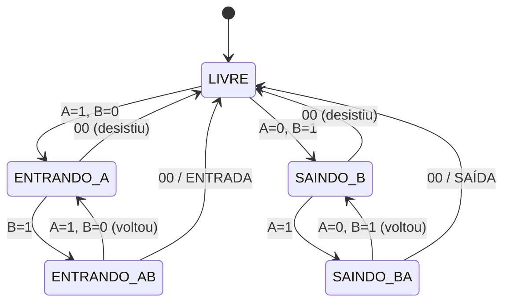

# Eletrônica digital: porta, contador e controle do ar-condicionado

Lógica digital do Movement em circuitos combinacionais e sequenciais, montados no Logisim e equivalentes ao firmware do ESP32. Atende ao requisito "Eletrônica Digital e Analógica" da ExpoTech 2026.2 ([issue #7](https://github.com/expotech2026-2/Projeto-Movement-2.0/issues/7)).

## 1. Objetivo e relação com o firmware

A sala tem **duas barreiras infravermelhas na mesma porta** (ver [Física, seção 9.2](fisica.md#92-barreiras-ipec-ir15-mini-saída-a-relé)): **A** do lado de fora e **B** do lado de dentro. Cada pessoa que passa corta os dois feixes, então o sentido vem da **ordem** dos cortes.



| Bloco | Tipo | Equivale no firmware a |
| --- | --- | --- |
| Máquina de estados da porta | Sequencial | `passoPorta()` |
| Contador de ocupação | Sequencial | `totalPessoas++` / `totalPessoas--` no `loop()` |
| Comparador de temperatura | Combinacional | `desvio > TOLERANCIA_AC` |
| Acionamento do resfriamento | Combinacional | `podeResfriar()` em `passoAC()` e `definirAlvoAC()` |

## 2. Entradas

- $A = 1$: feixe da barreira de fora interrompido; $B = 1$: feixe da barreira de dentro interrompido.
- Eletricamente, cada barreira é um contato de relé entre o GPIO e o GND, com pull-up: feixe livre → 0; feixe interrompido (ou fio cortado) → 1.
- O contato oscila por alguns milissegundos ao comutar. No firmware, `filtrarBarreira()` só aceita um nível que fique estável por 30 ms. No Logisim, as entradas são pinos ideais, sem oscilação.
- **Distância entre os feixes:** monte as barreiras a **pelo menos 15 cm** uma da outra. Andando a ~1 m/s, isso dá ~150 ms entre os cortes, cinco vezes os 30 ms do filtro. Cortes com menos de ~30 ms de diferença não têm ordem confiável: o filtro pode aceitar primeiro o contato que oscilou menos. O teste do firmware (seção 10) mostra exatamente esse caso.

## 3. Máquina de estados da porta (sequencial)

### 3.1 Estados

| Estado | Código $Q_2Q_1Q_0$ | Significado |
| --- | --- | --- |
| LIVRE | 000 | Ninguém na porta |
| ENTRANDO_A | 001 | Alguém cortou A primeiro (vindo de fora) |
| ENTRANDO_AB | 011 | Quem vinha de fora já alcançou B |
| SAINDO_B | 101 | Alguém cortou B primeiro (vindo de dentro) |
| SAINDO_BA | 111 | Quem vinha de dentro já alcançou A |

A codificação é simétrica: $Q_2$ é o sentido (0 = entrando, 1 = saindo), $Q_1$ indica que a pessoa já alcançou a segunda barreira e $Q_0$ indica que algum feixe foi cortado. Os códigos 010, 100 e 110 não são usados.



### 3.2 Tabela de transição

Gerada por `python hardware/logica/verificar_logica.py --markdown`:

| Estado | Q2 Q1 Q0 | A B = 00 | 01 | 10 | 11 |
| --- | --- | --- | --- | --- | --- |
| LIVRE | 000 | LIVRE | SAINDO_B | ENTRANDO_A | LIVRE |
| ENTRANDO_A | 001 | LIVRE | ENTRANDO_AB | ENTRANDO_A | ENTRANDO_AB |
| ENTRANDO_AB | 011 | LIVRE / ENTRADA | ENTRANDO_AB | ENTRANDO_A | ENTRANDO_AB |
| SAINDO_B | 101 | LIVRE | SAINDO_B | SAINDO_BA | SAINDO_BA |
| SAINDO_BA | 111 | LIVRE / SAÍDA | SAINDO_B | SAINDO_BA | SAINDO_BA |

A pessoa só é contada quando **os dois feixes ficam livres** depois de ter alcançado a segunda barreira. Isso cobre quem desiste na porta ou volta no meio do caminho. Cortar os dois feixes ao mesmo tempo, a partir de LIVRE, é ambíguo e não muda o estado.

### 3.3 Equações

Com flip-flops D ($Q^+ = D$) e os códigos não usados como "tanto faz", a minimização (Quine–McCluskey, conferida pelo script) dá:

$$D_2 = A\,Q_2 + B\,Q_2 + B\,\overline{A}\,\overline{Q_0}$$

$$D_1 = A\,Q_2 + B\,Q_0\,\overline{Q_2}$$

$$D_0 = B\,Q_0 + A\,\overline{B} + \overline{A}\,B$$

Saídas de Mealy, cada uma com um pulso de um ciclo de clock:

$$ENTRADA = Q_1\,\overline{Q_2}\,\overline{A}\,\overline{B} \qquad SAÍDA = Q_1\,Q_2\,\overline{A}\,\overline{B}$$

Leitura das equações:

- $D_0$ vale 1 quando exatamente um feixe está cortado, ou quando os dois estão cortados e alguém já estava na porta. É o "tem alguém na porta".
- $D_2$ guarda o sentido: com $Q_2 = 1$, ele fica em 1 enquanto qualquer feixe estiver cortado. Ele só vira 1 a partir de LIVRE ($\overline{Q_0}$) quando B é cortado sozinho.
- $D_1$ marca que a segunda barreira foi alcançada: B para quem entra ($\overline{Q_2}$) e A para quem sai ($Q_2$).
- **Autocorreção:** com $A = B = 0$, todos os termos valem 0, então qualquer estado, inclusive os inválidos, volta a LIVRE assim que a porta fica livre.

## 4. Contador de ocupação (sequencial)

Contador crescente/decrescente de 4 bits ($Q_3Q_2Q_1Q_0$, de 0 a 15 pessoas) com flip-flops T, alimentado pelos pulsos ENTRADA ($E$) e SAÍDA ($S$) da máquina de estados:

$$Z = \overline{Q_3}\,\overline{Q_2}\,\overline{Q_1}\,\overline{Q_0} \;(\text{vazia}) \qquad F_{cheia} = Q_3\,Q_2\,Q_1\,Q_0$$

$$UP = E\,\overline{S}\,\overline{F_{cheia}} \qquad DN = S\,\overline{E}\,\overline{Z}$$

$$T_0 = UP + DN \qquad T_1 = UP\,Q_0 + DN\,\overline{Q_0}$$

$$T_2 = UP\,Q_0\,Q_1 + DN\,\overline{Q_0}\,\overline{Q_1} \qquad T_3 = UP\,Q_0\,Q_1\,Q_2 + DN\,\overline{Q_0}\,\overline{Q_1}\,\overline{Q_2}$$

$$OCUPADA = Q_3 + Q_2 + Q_1 + Q_0 = \overline{Z}$$

**Dedução:** num contador binário crescente, o bit $i$ inverte quando todos os bits abaixo dele valem 1 (ex.: 0111 → 1000); no decrescente, quando todos valem 0 (ex.: 1000 → 0111). O flip-flop T faz exatamente essa inversão quando $T = 1$. $\overline{F_{cheia}}$ e $\overline{Z}$ impedem passar de 15 ou ficar abaixo de 0. O firmware não tem o limite de 15; ele imprime "Aviso: sala vazia" se houver uma saída com a sala vazia.

| Q | Q+ com ENTRADA | Q+ com SAÍDA |
| --- | --- | --- |
| 0 | 1 | 0 |
| 1 | 2 | 0 |
| 2 | 3 | 1 |
| 3 | 4 | 2 |
| 4 | 5 | 3 |
| 5 | 6 | 4 |
| 6 | 7 | 5 |
| 7 | 8 | 6 |
| 8 | 9 | 7 |
| 9 | 10 | 8 |
| 10 | 11 | 9 |
| 11 | 12 | 10 |
| 12 | 13 | 11 |
| 13 | 14 | 12 |
| 14 | 15 | 13 |
| 15 | 15 | 14 |

## 5. Comparador de temperatura (combinacional)

As temperaturas são codificadas em 5 bits sem sinal como $\text{código} = \text{round}(T) - 15$ (0 = 15 °C, 31 = 46 °C) e comparadas pelo componente *Comparator* do Logisim. A saída ">" é o sinal $A$ do acionamento ("está quente").

Exemplo: interna de 25 °C → $25 - 15 = 10$ = `01010`; alvo de 23 °C → 8 = `01000`; $10 > 8$, então $A = 1$.

## 6. Acionamento do resfriamento (combinacional)

**Especificação:** resfria se está quente ($A$), se não foi forçado a desligar ($C$, comando `AC_OFF`) e se está em modo manual ($M$) **ou** a sala está ocupada ($B$ = `OCUPADA`):

$$F = A \cdot \overline{C} \cdot (M + B)$$

| A | B | C | M | F | Mintermo |
| --- | --- | --- | --- | --- | --- |
| 0 | 0 | 0 | 0 | 0 |  |
| 0 | 0 | 0 | 1 | 0 |  |
| 0 | 0 | 1 | 0 | 0 |  |
| 0 | 0 | 1 | 1 | 0 |  |
| 0 | 1 | 0 | 0 | 0 |  |
| 0 | 1 | 0 | 1 | 0 |  |
| 0 | 1 | 1 | 0 | 0 |  |
| 0 | 1 | 1 | 1 | 0 |  |
| 1 | 0 | 0 | 0 | 0 |  |
| 1 | 0 | 0 | 1 | 1 | m9 |
| 1 | 0 | 1 | 0 | 0 |  |
| 1 | 0 | 1 | 1 | 0 |  |
| 1 | 1 | 0 | 0 | 1 | m12 |
| 1 | 1 | 0 | 1 | 1 | m13 |
| 1 | 1 | 1 | 0 | 0 |  |
| 1 | 1 | 1 | 1 | 0 |  |

Mapa de Karnaugh (linhas $AB$, colunas $CM$, em código Gray):

| AB \ CM | 00 | 01 | 11 | 10 |
| --- | --- | --- | --- | --- |
| 00 | 0 | 0 | 0 | 0 |
| 01 | 0 | 0 | 0 | 0 |
| 11 | 1 | 1 | 0 | 0 |
| 10 | 0 | 1 | 0 | 0 |

Grupos: $(m_{12}, m_{13}) = A\,B\,\overline{C}$ e $(m_9, m_{13}) = A\,\overline{C}\,M$.

- Soma de produtos mínima: $F = A\,B\,\overline{C} + A\,\overline{C}\,M$ (2 AND de 3 entradas, 1 OR, 1 NOT).
- Forma fatorada: $F = A\,\overline{C}\,(B + M)$, com 3 portas (NOT, OR de 2 entradas e AND de 3 entradas).

> Em relação ao firmware original, a regra é nova: no modo automático, o resfriamento só atua com a sala ocupada. Isso evita gastar energia com a sala vazia e deixa o software igual ao circuito.

O termo $\overline{C}\,(M + B)$ sozinho diz se o aparelho fica ligado. O firmware manda pelo LED IR o comando de ligar quando esse termo passa a 1 e o de desligar quando volta a 0, por exemplo quando a última pessoa sai no modo automático. $A$ só decide se o compressor resfria.

## 7. Equivalência com o firmware

```c
// firmware/climacontrol/sketch.ino
int passoPorta(bool a, bool b) {          // seção 3
  if (!a && !b) {                         // porta livre: conta se a passagem se completou
    int evento = estadoPorta == ENTRANDO_AB ? 1 : estadoPorta == SAINDO_BA ? -1 : 0;
    estadoPorta = PORTA_LIVRE;
    return evento;
  }
  ...
}

bool podeResfriar() {                     // seção 6: (M + B)
  return modoAtual == MODO_MANUAL || totalPessoas > 0;
}

bool acDeveFicarLigado() {                // seção 6: not(C) · (M + B), liga ou desliga pelo IR
  return !acForcadoOff && podeResfriar();
}
// atualizarResfriamento(): acDeveFicarLigado() && desvio > TOLERANCIA_AC  →  A · not(C) · (M + B)
```

O script `hardware/logica/verificar_logica.py` implementa a mesma especificação de `passoPorta()` (`door_spec`) e confere que as equações dos flip-flops a reproduzem.

## 8. Montagem no Logisim Evolution

Use o Logisim Evolution 3.8 ou mais novo (<https://github.com/logisim-evolution/logisim-evolution/releases>) e crie o projeto `hardware/logisim/movement.circ` com três circuitos (*Project → Add Circuit*).

**Circuito `porta`:**

1. Entradas (*Wiring → Pin*): `A`, `B`; *Wiring → Clock*.
2. Três **D Flip-Flop** (*Memory*) com clock comum: $Q_2$, $Q_1$, $Q_0$.
3. Lógica de próximo estado: monte $D_2$, $D_1$ e $D_0$ com portas AND, OR e NOT conforme a seção 3.3. Alternativa mais rápida: *Project → Analyze Circuit* (Combinational Analysis), com entradas $Q_2, Q_1, Q_0, A, B$ e saídas $D_2, D_1, D_0$; preencha a tabela de transição (códigos não usados como "x") e clique em *Build Circuit*.
4. Saídas `ENTRADA` e `SAIDA` com as equações de Mealy da seção 3.3.
5. Teste: com *Simulate → Ticks Enabled*, faça a sequência A=1 → A=1, B=1 → B=1 → nenhum. `ENTRADA` pisca uma vez. Faça a sequência inversa e `SAIDA` pisca.

**Circuito `contador`:**

1. Entradas `E` e `S` (das saídas da `porta`) e clock.
2. Quatro **T Flip-Flop** (*Memory*) e a lógica de $Z$, $F_{cheia}$, $UP$, $DN$ e $T_0$..$T_3$ da seção 4.
3. Saídas: **Hex Digit Display** (*Input/Output*), ligado a $Q_3..Q_0$ por um *Splitter*, e um **LED** `OCUPADA`.

**Circuito `controle_ac`:**

1. Entradas `T_INT` e `T_ALVO` (pinos de 5 bits), `OCUPADA`, `MANUAL` e `FORCADO_OFF`.
2. **Comparator** (*Arithmetic*), *Data Bits* = 5 e *Numeric Type* = *Unsigned*; a saída ">" é $A$.
3. $F$ = AND3($A$, NOT(`FORCADO_OFF`), OR(`OCUPADA`, `MANUAL`)), ligado a um LED `RESFRIAR`.

**Circuito principal:** instancie `porta` → `contador` → `controle_ac`, com o mesmo clock. Teste as 16 linhas da tabela da seção 6 e as sequências da seção 3.

Salve os prints em `docs/img/` (`porta-logisim.png`, `contador-logisim.png` e `controle-ac-logisim.png`).

## 9. Simulação no Wokwi

O Wokwi não tem as barreiras iPEC; no `diagram.json` os dois sensores de presença fazem o papel delas, nos mesmos pinos (A no GPIO 13, B no GPIO 26). O PIR do Wokwi fica em nível alto por alguns segundos depois de acionado, o que permite reproduzir a sobreposição dos feixes.

1. **Projeto pronto:** [Movement 2.0 - ESP32 (Devlop)](https://wokwi.com/projects/479966017431592961). Ele tem o `sketch.ino`, o `diagram.json`, a **DHT sensor library** e um `config.h` com o token `PREENCHA_LOCALMENTE`. Para montar do zero, use <https://wokwi.com/projects/new/esp32>, cole esses arquivos e acrescente a biblioteca no *Library Manager*.
2. **Envio para a API:** no `config.h`, informe:
   - `MOVEMENT_API_URL`, com o endereço do site seguido de `/api/telemetry`;
   - `MOVEMENT_CA_CERT`, com a CA raiz do domínio;
   - `MOVEMENT_DEVICE_TOKEN`, com o token do dispositivo (ver [issue #3](https://github.com/expotech2026-2/Projeto-Movement-2.0/issues/3)).

   Deixe de fora a linha `MOVEMENT_DHT_TYPE DHT11`, porque o Wokwi simula o DHT22.
3. **Token:** no plano gratuito, o Wokwi só salva projetos **públicos**. Cole o token só para rodar e **não salve** depois. O projeto salvo fica sempre com `PREENCHA_LOCALMENTE`.
4. **Velocidade:** mantenha a janela do navegador visível. Com a aba em segundo plano, a simulação cai para poucos por cento do tempo real. O `millis()` simulado não acompanha a rede, e o tempo medido no `[Movement] HTTP ... em N ms` sai baixo demais.
5. **Entrada:** clique em "Barreira A (fora)" e, menos de 2 s depois, em "Barreira B (dentro)". Quando os dois voltarem a 0, o monitor serial mostra `[PRESENCA] ENTRADA (+1)`. Na primeira entrada, o LED acende por 0,8 s e aparece `[IR] LIGAR (800 ms)`.
6. **Saída:** a mesma coisa, começando por B: `[PRESENCA] SAIDA (-1)`. Quando a última pessoa sai, o LED acende por 1,5 s e aparece `[IR] DESLIGAR (1500 ms)`.
7. **Regra do resfriamento:** com a sala vazia em modo automático, o status fica em "espera"; com alguém na sala e a temperatura acima do alvo, passa a "RESFRIANDO".
8. **Modo manual (entrada M):** digite no campo do monitor serial e tecle Enter.
   - `22` (ou outra temperatura de 18 a 30): mostra `[Manual] Comando recebido: 22` e `[MODO] -> MANUAL`, e o resfriamento passa a atuar mesmo com a sala vazia.
   - `AC_OFF`: força o compressor desligado ($\overline{C}$ = 0) e manda `[IR] DESLIGAR`.
   - `AUTO`: volta ao automático.

## 10. Verificação automatizada

```bash
python hardware/logica/verificar_logica.py            # OK: ... conferidas
python hardware/logica/verificar_logica.py --markdown # tabelas desta página
python hardware/logica/testar_firmware.py             # OK: 13 cenarios da porta e 22 passos do IR
```

`verificar_logica.py` confere:

- as 20 transições da porta (5 estados × 4 entradas) contra a especificação;
- que os 3 códigos inválidos voltam a LIVRE;
- 7 sequências de passagem: entrada, saída, entrada rápida, desistência, volta no meio, dois feixes juntos e duas entradas;
- as 64 transições do contador;
- as 16 combinações de $F$ (especificação × forma mínima).

`testar_firmware.py` extrai `passoPorta()` e `filtrarBarreira()` do próprio `sketch.ino`, compila com `hardware/logica/teste_porta.cpp` (com `-Wall -Wextra -Werror`) e roda as mesmas sequências chamando a lógica a cada 10 ms, como o `loop()`. Cada sequência roda sem ruído e com o contato oscilando duas vezes antes de assentar (13 cenários). O único caso excluído com ruído é o dos dois feixes cortados ao mesmo tempo, que não tem ordem definida.

O mesmo script extrai `podeResfriar()`, `acDeveFicarLigado()`, `estadoNovoParaEnviar()` e `proximoComandoIR()` e confere, com `hardware/logica/teste_ir.cpp`, 22 passos: nos pulsos simulados, ligar na primeira entrada, subir e baixar 1 °C por pulso, desligar quando a sala esvazia ou com `AC_OFF` e não mexer no alvo com o aparelho desligado; no protocolo real, um quadro só por mudança, com o estado inteiro. Os dois scripts rodam no job `firmware` da CI.

## 11. Prints


